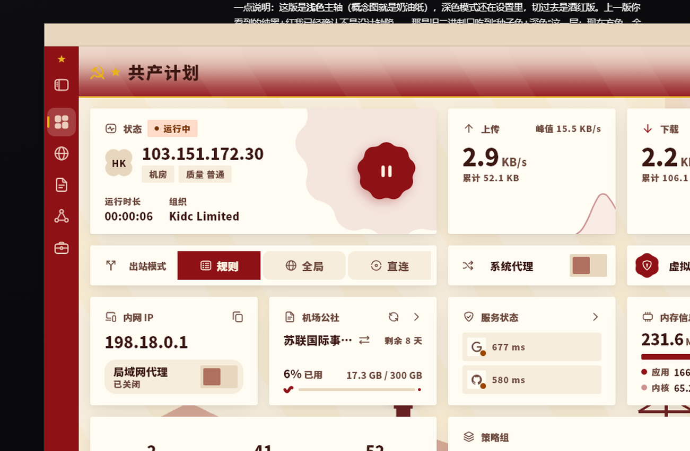
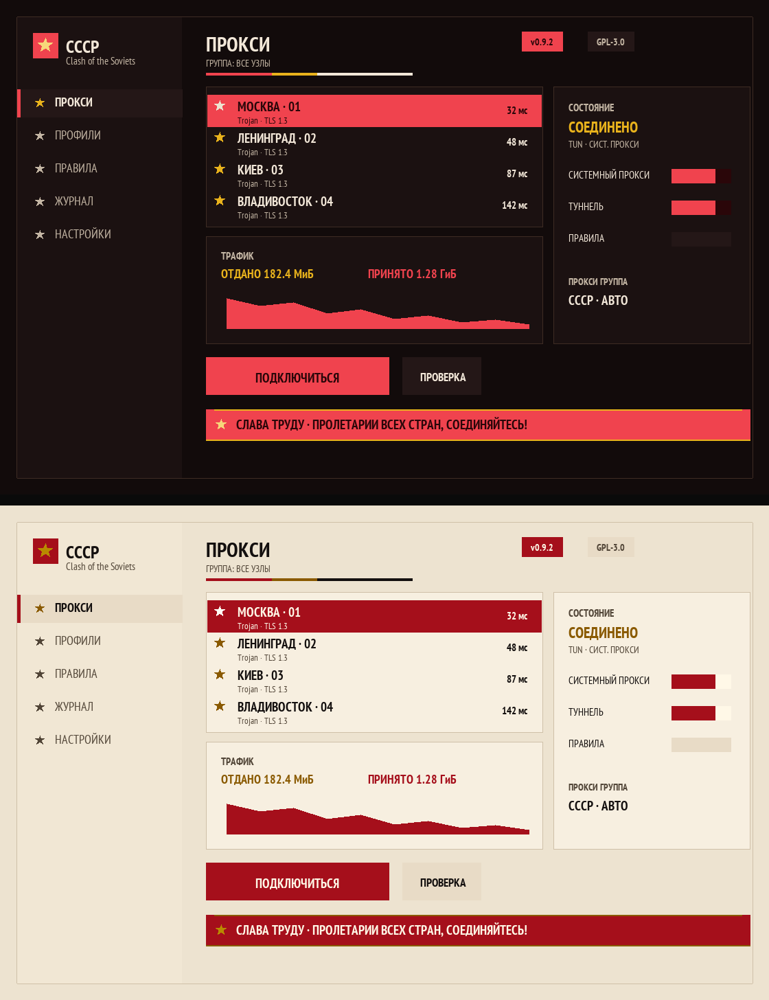

# flclash-soviet

把 [FlClash](https://github.com/chen08209/FlClash) 的界面改成苏联宣传画风格的**主题补丁**：
奶油纸底、深红标题带、金色锤镰与五角星、印刷品直角、工厂天际线剪影，以及一套重绘的图标 / 托盘 / 字体。



> 非官方修改，GPL-3.0，基于 FlClash `v0.9.2`。本仓库只分发**源码级改动与美术素材**，不含任何编译产物。

---

## 效果

| 部位 | 做法 |
| --- | --- |
| 主色板 | 浅色 = 做旧奶油纸 `#F4EADA` + 深红 `#8E1116`；深色 = 酒红底 + 亮红 |
| 标题带 | 深红横带 + 金线，左侧金色锤镰徽标 + 金星 + 页面标题（标题字色转米白） |
| 侧栏 | 深红实底、米白图标与文字、金色选中指示条 |
| 圆角 | 全局 2 dp（`AppCorner` + 仪表盘专用 `DashboardCorner`）→ 印刷品直角 |
| 字体 | 全 UI 换 `Noto Sans SC Black`（海报粗黑），数字与拉丁/西里尔用 `PT Sans Narrow` |
| 背景 | 48° 斜光带 + 列宁剪影暗纹（同色系 `srcIn` 着色）+ 底部工厂/烟囱/塔吊天际线 |
| 状态色 | 成功 = 金、警告 = 赭、错误 = 橙，全应用不再出现绿色 |
| 图标 | 红底金边 + 金星内镂空锤镰（应用图标）；托盘四态 = 灰/红/金/赭的描边五角星 |
| 立绘 | 关于页两位贡献者头像换成列宁 / 斯大林的双色调海报像 |
| 文案（中文） | 仪表盘 → 共产计划，代理 → 共产国际，配置 → 机场公社 |



---

## 两种装法

### A. 只换外观（不用编译，约 5 分钟）

适用于官方发布版（资源结构同版本）。

```powershell
python tools\apply_runtime_assets.py --built "C:\Program Files\FlClash"
```

脚本会：替换 `data\flutter_assets\assets\images` 下的图标/头像/托盘图标 → 拷入两款字体并注册进
`FontManifest.json` → 把 `%APPDATA%\com.follow\clash\shared_preferences.json` 里的
`themeProps` 改成苏联配色。原文件备份在 `<FlClash>\.soviet-backup\`，`--restore` 可还原。

**必须先关掉 FlClash**：运行中这些文件被内存映射锁定（WinError 1224），配置也会在退出时被应用回写。

这种方式拿不到直角、标题带、侧栏红底、天际线这些需要编译的效果，只能换色与素材。

### B. 源码补丁 + 重新编译（完整效果）

```powershell
git clone https://github.com/chen08209/FlClash.git
cd FlClash
git checkout v0.9.2

# 文本改动
git apply ..\flclash-soviet\patches\0001-soviet-theme.patch
# 二进制素材与字体（补丁里不含）
Copy-Item -Recurse -Force ..\flclash-soviet\overlay\* .

flutter pub get
flutter build windows --release
```

构建要踩的三个坑（符号链接、MAX_PATH、缺失的子模块产物）写在
[docs/build.md](docs/build.md)，实测 Flutter 3.47.6 + VS Build Tools 2022 可一次编过。

`overlay/` 是**全部改动文件的完整副本**，懒得分补丁的话直接整体覆盖上游源码树也行。

---

## 目录

```
overlay/        改动后的完整文件（13 个源码 + 18 个图片 + 3 个字体），直接覆盖到源码树
patches/        仅文本改动的 unified diff（13 files changed, 767 insertions, 90 deletions）
tools/          apply_runtime_assets.py —— 免编译换肤
tools/artwork/  生成图标、托盘、海报、天际线的 Pillow 脚本（路径按本机改）
licenses/       PT Sans Narrow 与 Noto Sans SC 的 SIL OFL 1.1 许可
docs/           截图与构建说明
```

## 改了哪些源码

| 文件 | 改动 |
| --- | --- |
| `lib/ui/soviet.dart` | **新增**：锤镰/五角星 `CustomPainter`、丝带条幅、四角框、三色旗条、苏联色板常量 |
| `lib/ui/color.dart` | `seededColorScheme` 尾部接 `_sovietTint`：种子色落在红区时按角色覆写整套 `ColorScheme`（浅色奶油纸 / 深色酒红），非红种子原样返回 |
| `lib/ui/shape.dart` | `AppCorner` 全部收敛到 2 dp |
| `lib/ui/typography.dart` | 标题字重提到 w800–w900，caption 加字距 |
| `lib/ui/scaffold.dart` | 标题带 `_BarBand`、页面标题前缀金星与锤镰、斜光带 + 天际线 + 列宁暗纹背景、底部三色旗条、四角金框 |
| `lib/ui/sidebar.dart` | 苏式配色下侧栏铺主色、图标/文字转米白、选中态金色指示条 |
| `lib/views/dashboard/style.dart` | `DashboardCorner` 32/34/20/22/16 → 2–3 dp（卡片圆角的真正来源） |
| `lib/views/about.dart` | 关于页 logo 加四角金框 + 旗帜条 + 口号条幅 |
| `lib/models/config.dart` | 默认主题：苏联红种子、浅色、`SovietPoster` 字体 |
| `lib/common/constant.dart` | `defaultPrimaryColor` 与预设色板换成苏联八色 |
| `lib/l10n/intl/messages_zh_CN.dart` | 共产计划 / 共产国际 / 机场公社 |
| `pubspec.yaml` | 注册 `PTSansNarrow`、`SovietPoster` 字体族与 `assets/images/soviet/` |

## 素材与许可

- 锤子镰刀、苏联国旗、列宁 1920 年照片、斯大林官方肖像：**Wikimedia Commons，公有领域**
- PT Sans Narrow：ParaType Ltd.，SIL OFL 1.1（见 `licenses/`）
- Noto Sans SC Black：Google / Adobe，SIL OFL 1.1（见 `licenses/`）
- 五角星、徽标、天际线、图标、海报、托盘图标：本仓库脚本用 Pillow 生成，随本仓库 GPL-3.0 分发

## 已知限制

- 只在 Windows 桌面上构建 / 验证过；macOS、Linux、Android 未测
- 资源管理器里显示的 exe 内嵌图标没有替换（需要 `rcedit` 之类的工具改 PE 资源）
- 深色模式的调色是按酒红手调的，个别二级容器色可能仍需微调
- 内置字体让安装体积增加约 9.7 MB

## 声明

非官方项目，与 FlClash 作者无关。FlClash 的版权归 chen08209 及贡献者所有，以 GPL-3.0 发布；
本仓库作为其衍生作品同样以 GPL-3.0 发布（见 `LICENSE`）。仓库只包含界面美术与文案改动，
不包含任何二进制、也不包含任何网络代理服务。
